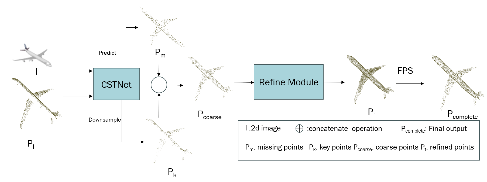

# VGTNet: Cross Modal Point Cloud Completion with Geometric Transformation

**Chuxiu Yu and Takeshi Oishi** · The University of Tokyo

[Paper](CGVI2025_Yu.pdf) · [中文说明](README.zh-CN.md) · [Reproduction notes](docs/reproduction.md)

VGTNet completes a partial point cloud using a single RGB image and learned geometric transformations. CGTNet predicts missing geometry from 512 input keypoints, producing a 1024-point coarse shape. Image-guided refinement upsamples it to 4096 points; farthest point sampling (FPS) produces the final 2048-point output.



This is a cleaned research implementation of the accompanying paper. The figure's historical label `CSTNet` corresponds to CGTNet in the paper text. [models/vgtnet.py](models/vgtnet.py) was extracted from the original `SymmCompletion3` with model parameter names preserved.

## Installation

The intended environment is Linux with an NVIDIA GPU, a CUDA toolkit including `nvcc`, and a C++ compiler. Use one GPU per process. Python 3.9, PyTorch 2.1.2, torchvision 0.16.2 and CUDA 11.8 are a starting environment inherited from the research repository; this release has **not yet been benchmark-validated on that stack**. Check extension compilation on your machine.

```bash
conda create -n vgtnet python=3.9 -y
conda activate vgtnet
python -m pip install "setuptools>=65,<70" wheel
python -m pip install torch==2.1.2 torchvision==0.16.2 --index-url https://download.pytorch.org/whl/cu118
python -m pip install -r requirements.txt
python scripts/install_extensions.py
python scripts/smoke_test.py
```

Install a compatible CUDA 11.8 toolkit and compiler separately; the PyTorch wheel alone does not supply `nvcc`. Set `CUDA_HOME` if needed. Only PointNet++ and Chamfer Distance are required. EMD, PyTorch3D, PCL, wandb, timm and duplicate FPS extensions are no longer dependencies.

CPU repository checks require only Python:

```bash
python -m unittest discover -s tests -v
python -m compileall -q main.py datasets models run utils extensions scripts tests
python main.py --help
```

## Dataset

Obtain ShapeNet-ViPC from the [original ViPC project](https://github.com/Hydrogenion/ViPC) and follow its access and usage terms. Data and pretrained weights are not bundled.

```text
ShapeNetViPC-Dataset/
├── ShapeNetViPC-Partial/<category>/<object>/<view>.dat
├── ShapeNetViPC-GT/<category>/<object>/<view>.dat
└── ShapeNetViPC-View/<category>/<object>/rendering/
    ├── 00.png ... 23.png
    └── rendering_metadata.txt
```

The `.dat` files are original pickled NumPy arrays. The loader rotates partial scans into the selected image frame and normalizes both clouds using the GT center/radius. Images are RGB, resized to 224 × 224 and scaled to [0, 1]. Both point clouds are sampled to 2048 points before the model. By default, the image view is sampled independently of the scan view; evaluation fixes its per-sample seed. `--view-align` selects matching views.

Original split files are stored losslessly in [data/splits](data/splits), with SHA-256 checksums in [manifest.json](data/splits/manifest.json). Plain `.txt` splits also work. Original row membership is preserved; these are **not object-disjoint splits**. Read the reproduction notes before comparing protocols.

```bash
python scripts/check_data.py --data-root /path/to/ShapeNetViPC-Dataset --category plane
```

`--category all` selects the eight seen categories: `plane`, `cabinet`, `car`, `chair`, `lamp`, `couch` (sofa), `table`, `watercraft`. Evaluation also supports `--category unseen`: `bench`, `monitor`, `speaker`, `cellphone`. The original lists include `firearm`, which is excluded from `all`.

## Training

```bash
python main.py train --data-root /path/to/ShapeNetViPC-Dataset --category plane --output outputs/plane
```

Defaults follow the paper's common settings: Adam, 200 epochs, batch size 64, learning rate 0.0005, style weight 0.03. Learning rate decays by 0.7 every 20 epochs. Euclidean Chamfer loss supervises the 1024-, 4096- and 2048-point stages. Category-specific optimum settings and paper-result checkpoints are unavailable in this snapshot.

Experiments save configurations, per-epoch JSON metrics, `last.pth`, `best.pth`, and periodic checkpoints. Best weights minimize category-averaged CD-L2 on `--val-split`. The default is the original test list, matching historical checkpoint selection; supply a separate `--val-split` for held-out model selection.

```bash
# Resume optimizer, scheduler, epoch and RNG state with the same experiment settings.
python main.py train --data-root /path/to/ShapeNetViPC-Dataset --category plane --output outputs/plane --resume outputs/plane/last.pth

# Initialize model weights from a historical SymmCompletion3 checkpoint.
python main.py train --data-root /path/to/ShapeNetViPC-Dataset --category plane --output outputs/plane-new --init-checkpoint /path/to/old-checkpoint.pth
```

Use `--workers 0` for loader debugging and `--device 0` to select a GPU. Run commands from the repository root. See `python main.py train --help` for other settings.

## Evaluation

No VGTNet pretrained checkpoint is bundled or linked. Supply your own checkpoint; the unrelated EGIInet download link has been removed.

```bash
python main.py test --data-root /path/to/ShapeNetViPC-Dataset --category plane --checkpoint outputs/plane/best.pth --output outputs/plane-evaluation.json

# Use a model trained on the eight seen categories for generalization evaluation.
python main.py test --data-root /path/to/ShapeNetViPC-Dataset --category unseen --checkpoint /path/to/seen-category-model.pth --output outputs/unseen-evaluation.json
```

Evaluation loads weights strictly, includes the final incomplete batch, and reports sample-weighted and category-averaged results. CD-L2 is the sum of the two mean squared nearest-neighbor distances, reported ×1000. F-score uses a **squared-distance** threshold of 0.001. CD-L1 uses the half-sum of mean Euclidean distances and is also reported ×1000.

The paper reports mean CD-L2 ×1000 / F-score of **1.006 / 0.878** on seen categories (Tables 1–2) and **1.243 / 0.859** on unseen categories (Table 3). These are paper results, **not newly reproduced results from this cleanup**.

## Inference on a prepared pair

```bash
python main.py infer --checkpoint /path/to/model.pth --partial /path/to/partial.npy --image /path/to/image.png --output outputs/completion.npy
```

Input points must be a finite `N × 3` NumPy array, `N >= 2048`, already aligned to the image camera and normalized to the training frame/scale. Inference needs no GT and does not estimate camera pose or scale. Output is an `2048 × 3` NumPy array in the input coordinate system.

## Layout

| Path | Purpose |
| --- | --- |
| `main.py` | train / test / infer CLI |
| `models/` | VGTNet and its point/attention utilities |
| `datasets/`, `data/splits/` | loader, original splits and checksums |
| `extensions/` | required CUDA sources and upstream licenses |
| `run/engine.py`, `utils/` | training, evaluation, checkpoints and metrics |
| `scripts/`, `tests/` | extension build, data checks, CUDA smoke test, CPU checks |
| `docs/`, `licenses/` | reproduction details and upstream notices |

## Citation

The metadata below uses details available in the bundled manuscript; no report number, volume or DOI is inferred.

```bibtex
@misc{yu2025vgtnet,
  title = {Cross Modal Point Cloud Completion with Geometric Transformation},
  author = {Yu, Chuxiu and Oishi, Takeshi},
  year = {2025},
  note = {IPSJ SIG Technical Report}
}
```

## Acknowledgements and license

This implementation builds on [SymmCompletion](https://github.com/HKUST-SAIL/SymmCompletion), [SVDFormer](https://github.com/czvvd/SVDFormer_PointSea), [EGIInet](https://github.com/WHU-USI3DV/EGIInet), [ViPC](https://github.com/Hydrogenion/ViPC) and PointNet++/Chamfer CUDA utilities. XMFNet and Meta-Transformer influenced earlier experiments, excluded from this release.

Original contributions use the [MIT License](LICENSE). Retained third-party code keeps its notices; see [THIRD_PARTY_NOTICES.md](THIRD_PARTY_NOTICES.md). Dataset, paper and model weights have separate rights and are not covered by the code's MIT license.
